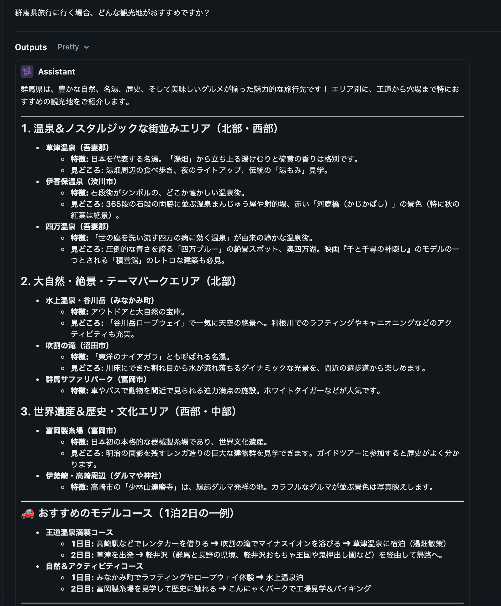
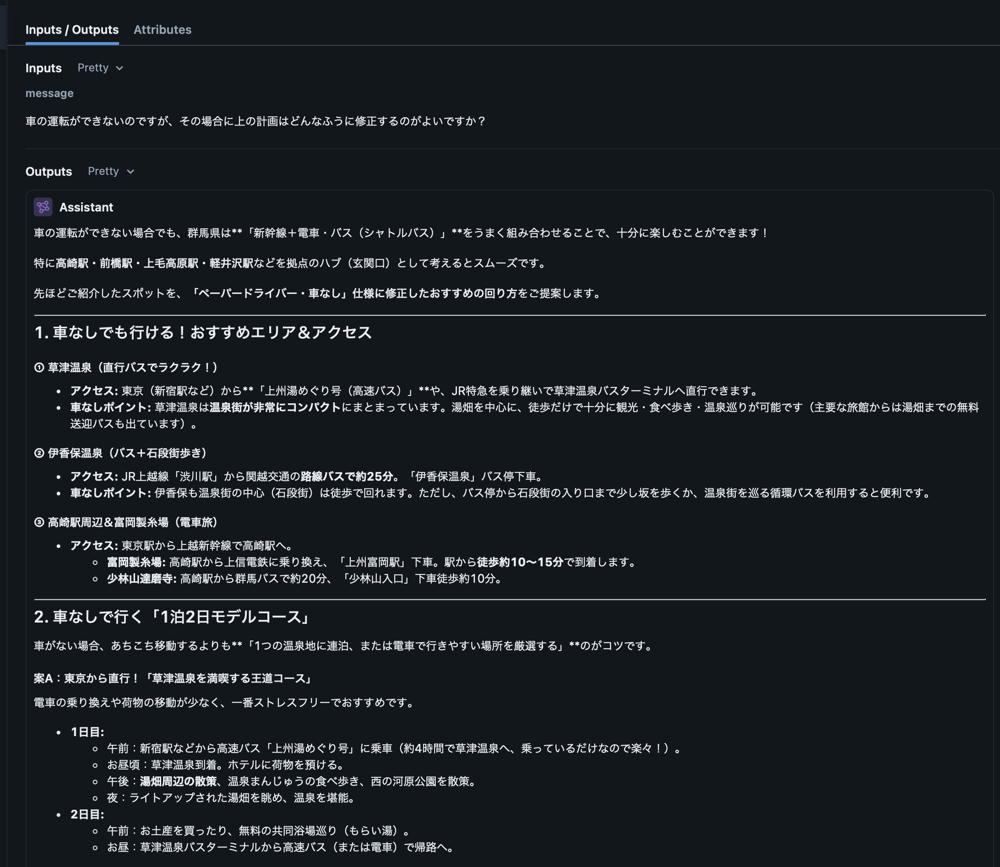
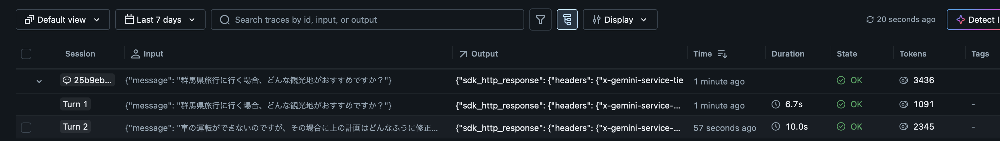

# 第1回 解答

## 演習

- 講座に固有の質問（宿題の3レベル）へのモデルの回答（要約でよい）：

  「分からない」という素直な回答ではなく、一般的に
   - レベル1：基礎（Basic / Beginner）
   - レベル2：応用（Intermediate / Standard）
   - レベル3：発展（Advanced / Expert）

   などというレベル分類がされることが多いとし、「具体的には運営や講師に質問するように」という回答。

- 用語集の正しい意味と比べて気づいたこと：

  用語集に記載の正解は
  
  ```
  AIE2026の宿題の構成。
  「基礎（講義内容の確認）」
  「実装（自分でコードを書く）」
  「発展（調査や試行）」の3段階があり、どれか1つに取り組めば
  その回の宿題は完了。原則として採点はしない。
  ```
  
  とあり、紛らわしいがあくまで一般論の回答を返してきているため、不適切な回答であることがわかる。

- 表示できたトークン数（入力 / 出力）：

  | フェーズ | トークン数 |
  | -------| --------- |
  | 入力    | 21       |
  | 出力     | 658     |

## 宿題

- 取り組んだレベル： 発展

### 実装：会話履歴を保ったまま続けて質問できるようにする

#### 実装：やったこと

まず、`app/ask.py`に対して、「実装」レベルの内容である会話履歴を保ったまま続けて質問できるような対応を行った。
  
```
uv run python -m app.ask -c
```

と実行することで、会話履歴を保ったまま続けて質問できるモードを追加した。
  
また、mlflow をローカルでセットアップしてトラッキングを可能として、入出力トークン数や応答時間などを自動的に計測できるようにした。
もともと genai SDK の chats モジュールに会話履歴を自動的に保持する API が用意されているようなので、それを利用した。

#### 実装：結果

まず、群馬県に旅行に行く想定で、おすすめの観光地を聞いてみた。各スクリーンショットは mlflow のトレースの画面である。



レンタカーを借りる計画を提案されたので、二回目のメッセージで「車の運転ができないので、計画を修正して欲しい」とだけ伝えた。



２回めのメッセージでは「群馬県に旅行に行く」とは伝えていないのに、引き続き群馬県の旅行情報を提示してくれており、会話履歴が保たれている事がわかる。

また、mlflow の画面での単一のセッションで会話スレッドとしてまとめられている。



#### 実装：気づき・疑問

- mlflow の自動トラッキングを利用するとトークン数や推定コスト、応答時間などがわかりやすく記録できる
- 本実装を行う際に、Open AI の API なども調査してみたが、意外にも会話履歴などの保持を標準ではサポートしておらず、自身で管理するか、LangChain などのエージェント作成のライブラリなどの利用が必要であることが分かった。

### 発展：複数のモデル・質問での応答時間・トークン数比較とレート制限に関する考察

#### やったこと

「実装」で実現したチャットプログラムを利用して、二種類の質疑を、二種類のモデルを利用して行い、入出力トークン数、応答時間などを調査した。
各質疑では、下記の順序で会話を継続して行う。同じ質疑を三回づつ各モデルに対して行った。

1. Turn (1) の質問を入力
2. Turn (1) の応答を受領
3. Turn (2) の質問を入力
4. Turn (2) の応答を受領

##### 使用モデル

- `gemini-3.5-flash-lite`
- `gemini-3.8-flash` 

##### 質疑 1

| 会話ターン | 質問                                            |
| -------- | ----------------------------------------------- |
| Turn (1) | 深層生成モデルのフローマッチングについて詳説してください |
| Turn (2) | Rectified Flow とどのような関係がありますか？       |

##### 質疑 2

| 会話ターン | 質問                                            |
| -------- | ----------------------------------------------- |
| Turn (1) | 群馬県旅行に行く場合、どんな観光地がおすすめですか？     |
| Turn (2) | 車の運転ができないのですが、その場合に上の計画はどんなふうに修正するのがよいですか？|

#### 発展：結果

- 入力トークン(n) などは、Turn (n) の入力トークンを示す
- 出力トークン、思考トークン、応答時間も同様

##### 質疑１: 深層生成モデルについての質疑

| モデル | 入力トークン(1) | 出力トークン(1) | 思考トークン(1) | 入力トークン(2) | 出力トークン (2) | 思考トークン(2)| 応答時間 (1) | 応答時間 (2) |
| -- | -- | -- | -- | -- | -- | -- | -- | -- |
|`gemini-3.5-flash-lite`|14|1647|n/a|1671|1243|n/a|10.0s|12.4s|
|`gemini-3.5-flash-lite`|14|1493|n/a|1518|1140|n/a|12.6s|26.0s|
|`gemini-3.5-flash-lite`|14|1685|n/a|1709|1181|n/a|14.6s|6.4s|
|`gemini-3.8-flash`     |14|2266|1621|3912|1531|1621|1.5min|2.1min|
|`gemini-3.8-flash`     |14|2224|1561|3810|1615|1015|1.5min|2.4min|
|`gemini-3.8-flash`     |14|2230|1695|4050|1450|1120|51.8s|2.9min|

##### 質疑２：群馬県旅行についての質疑

| モデル | 入力トークン(1) | 出力トークン(1) | 思考トークン(1) | 入力トークン(2) | 出力トークン (2) | 思考トークン(2)| 応答時間 (1) | 応答時間 (2) |
| -- | -- | -- | -- | -- | -- | -- | -- | -- |
|`gemini-3.5-flash-lite`|15|1184|n/a|1207|1080|n/a|10.0s|10.5s|
|`gemini-3.5-flash-lite`|15|1067|n/a|1104|1163|n/a|10.3s|7.5s|
|`gemini-3.5-flash-lite`|15|1232|n/a|1268|971|n/a|12.9s|10.0s|
|`gemini-3.8-flash`     |15|1239|916|2192|1275|1521|2.7min|2.3min|
|`gemini-3.8-flash`     |15|1342|980|2359|1035|1205|3.6min|25.6s|
|`gemini-3.8-flash`     |15|1192|985|2214|1160|1199|2.4min|2.4min|

#### 発展：気づき・疑問

`gemini-3.5-flash-lite` では応答が早く、ストリーム生成する API を利用しなくてもチャットとしてそれほど違和感がない。

対して`gemini-3.8-flash` は１回の応答生成に`分`オーダーで時間がかかっており、ストリーム生成する API を使用していないこともありチャットとしての体感は厳しいものとなった。
無料枠で利用したため Tier などの問題で応答が遅いのかとも考えたが、そのような公式情報は見つからなかった。どちらかというと思考レベルを何も指定していないことが影響していた可能性がある。
実際、`gemini-3.8-flash` では思考トークンが計測されており、Turn (2) への入力トークン数が Turn (1) の入力トークン数と出力トークン数を単純に足し合わせたものから大幅に超過したものが次 Turn に引き継がれており、ユーザーに提示される出力されるトークンよりも実際にはかなり多くのトークンを生成していることが分かる。

専門的な質問である質疑１のほうが概ねトークン数が多い結果となったが、両者の応答時間にはそれほど目立った差異が見られない、もしくは質疑２のほうが長い傾向すらある。
一方で生成トークン数は質疑１のほうが傾向としては多いと言える。
特に `gemini-3.8-flash` を利用した場合、応答時間の予測可能性が低く、ばらつきが大きい。

レート制限については、RPD が 20 程度だったため、これを超過しないよう実験では使用回数を抑制する必要があった。

また、1 分あたりの最大リクエスト数を超えていないにもかかわらず、下記のようなエラーとなることがあった。

```
セッション開始： a9c02802df184912a7c025f97926044f
Hello!

> 深層生成モデルのフローマッチングについて詳説してください
モデルが混み合っています（503）。少し待ってから再実行してください。
```

おそらく無料枠ということもあり、資源を優先的に割り当てられることがなく、掲出されているレート制限に関わりなく制限を受けることがあるものと予想される。
